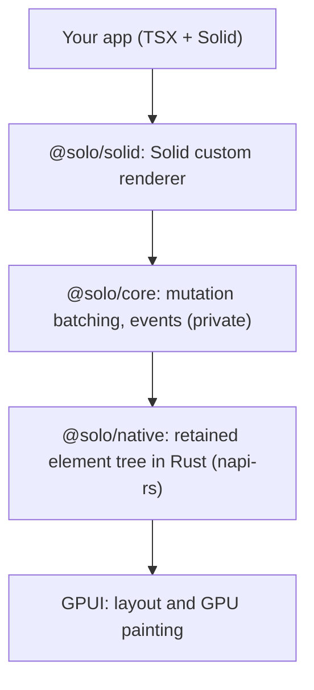

# Solo

Native, GPU-rendered desktop apps written in TypeScript and Solid.

Solo renders Solid components straight to the GPU through
[GPUI](https://github.com/zed-industries/zed/tree/main/crates/gpui), the UI
framework behind the Zed editor. There is no browser engine and no DOM: your
JSX becomes native elements in a Rust tree, painted with Metal, Vulkan or
DirectX.

Solo is pre-1.0 (`0.4.0`) and is not published to npm. You build it from
source. macOS is the primary platform; see [Platform status](#platform-status).

## Contents

- [Quick start](#quick-start)
- [Requirements](#requirements)
- [How it works](#how-it-works)
- [What you can build](#what-you-can-build)
- [Development loop](#development-loop)
- [Shipping an app](#shipping-an-app)
- [Automation](#automation)
- [Testing](#testing)
- [Platform status](#platform-status)
- [Current boundaries](#current-boundaries)
- [Packages](#packages)
- [Acknowledgements](#acknowledgements)

## Quick start

```bash
git clone https://github.com/octacity-org/solo.git
cd solo
bun install
bun run build                  # native addon, then @solo/core and @solo/solid
cd examples/solid-counter
bun run start                  # vite build, then bun dist/index.js
```

The first native build compiles GPUI and takes a few minutes.

An app is a Solid component passed to `render()`:

```tsx
import { createSignal } from "solid-js"
import { render, View, Text, Button } from "@solo/solid"

function Counter() {
  const [count, setCount] = createSignal(0)
  return (
    <View style={{ display: "flex", gap: 12 }}>
      <Text>{count()}</Text>
      <Button onClick={() => setCount((v) => v + 1)}>Increment</Button>
    </View>
  )
}

render(() => <Counter />, { title: "Counter", width: 480, height: 320 })
```

and a Vite config that compiles JSX for Solo:

```ts
import { defineConfig } from "vite"
import { solidUniversal } from "@solo/solid/vite"

export default defineConfig({
  plugins: [solidUniversal()],
  build: { ssr: "index.tsx", outDir: "dist", target: "node20" },
})
```

Applications import only `@solo/solid`, plus `solid-js` (Solid 2,
`2.0.0-rc.21`).

## Requirements

| Tool | Version |
|---|---|
| Bun | required to run apps; Node is not supported on macOS |
| Rust | 1.98.1, pinned in `rust-toolchain.toml` to match GPUI |
| Xcode Metal Toolchain (macOS) | `xcodebuild -downloadComponent MetalToolchain` |

## How it works



Solo is description-driven. Solid never keeps a JavaScript DOM. Each reactive
update queues the smallest set of native mutations (`createElement`,
`appendChild`, `setText`, `setStyle`, and so on), and one `applyBatch` call
per microtask sends them to Rust. A signal that changes one label produces
one `setText`, not a re-render.

Native events arrive by element id and dispatch to your Solid handlers.

On macOS, GPUI owns the process main thread and your app runs in a Bun
`Worker`. A production build emits two files for this: `index.js`, which
starts the native loop, and `index.app.js`, your app.

## What you can build

**Elements.** `View`, `Text`, `Button` and `VirtualList` components, plus the
native elements `div`, `text`, `img`, `svg`, `input`, `textarea`,
`anchored`, `code`, `diff` (unified patches), `markdown` (GFM),
`virtual-list` and `webview` (a real WKWebView on macOS, a WebKitGTK child
window on Linux/X11).

**Styling.** A CSS-like subset (`StyleDesc`) applied natively: flexbox,
borders, opacity, hover and active states, scrolling, and text metrics.
GPUI's default `display` is block, so set `display: "flex"` wherever you use
flex properties.

**Large lists.** `VirtualList` mounts only the rows near the viewport:

```tsx
<VirtualList
  items={entries()}
  key={(entry) => entry.path}
  estimatedItemHeight={30}
  overdraw={300}
  renderRow={(entry) => <Row entry={entry} />}
/>
```

Rows outside the mounted range paint as placeholders at the estimated height,
so a row can appear one frame after it scrolls into view. The row holding
focus stays mounted. `scrollToItem` takes an item index.

**Scrolling.** Nested scroll containers pass wheel input to their ancestors.
Set `overscrollBehavior: "contain"` (or `overscrollBehaviorX` /
`overscrollBehaviorY`) to stop it at an inner container.

**Syntax highlighting.** Tree-sitter highlighting for `code`, `diff` and
markdown code blocks is opt-in: build `@solo/native` with a `syntax-*`
feature (`syntax-all` adds every grammar, about 8 MB). Without one, code
renders as plain text.

**Desktop integration (macOS).**

| Feature | API | Guide |
|---|---|---|
| More windows sharing app state | `openWindow()` | [multiple-windows.md](docs/multiple-windows.md) |
| Screens, and opening a window on one | `getScreens()`, `onScreensChanged()`, the `screen` window option | [multiple-windows.md](docs/multiple-windows.md#screens) |
| Fullscreen, minimize, background and size of an open window | `toggleFullscreen()`, `minimize()`, `setBackground()`, `resize()` | [multiple-windows.md](docs/multiple-windows.md#window-state) |
| Confirm before a window closes | `onCloseRequest`, `requestClose()` | [multiple-windows.md](docs/multiple-windows.md#close-requests) |
| Unsaved-changes marker and title-bar file icon | `setDocumentEdited()`, `setDocumentPath()` | [multiple-windows.md](docs/multiple-windows.md#document-windows) |
| Window tabs | `tabbingIdentifier`, `setTabbingIdentifier()`, `toggleTabOverview()` | [multiple-windows.md](docs/multiple-windows.md#window-tabs) |
| App-drawn titlebars that drag and double-click like the system one | `windowDragRegion`, `appOwnsTitlebarDrag` | [multiple-windows.md](docs/multiple-windows.md#custom-titlebars) |
| Context menus | `createContextMenu()` | [context-menus.md](docs/context-menus.md) |
| Application commands | `registerApplicationCommand()` | [application-commands.md](docs/application-commands.md) |
| Menu-bar apps that outlive their windows | `render(..., { menuBar })`, `configureMenuBar()` | [menu-bar-apps.md](docs/menu-bar-apps.md) |
| Reopen on the app-icon click | `onApplicationReopen()` | [menu-bar-apps.md](docs/menu-bar-apps.md#getting-the-window-back) |
| Alerts | `showAlert()` | [alerts.md](docs/alerts.md) |
| Notification Center notifications and their buttons | `showNotification()`, `dismissNotification()`, `onNotificationResponse()` | [notifications.md](docs/notifications.md) |
| Open, folder and save dialogs | `selectFiles()`, `selectSavePath()` | [file-dialogs.md](docs/file-dialogs.md) |
| Files dropped from Finder | `onFileDrop`, `fileDragOver` style | [file-drop.md](docs/file-drop.md) |
| Deep links and opened files | `onOpenUrls()`, `registerUrlScheme()` | [deep-links.md](docs/deep-links.md) |
| Dock reopen, menu and recent documents | `onApplicationReopen()`, `configureDockMenu()`, `addRecentDocument()` | [dock.md](docs/dock.md) |
| App data, config, cache and log directories; bundled resources; app name and version | `appPaths()`, `ensureDir()`, `appInfo()` | [app-directories.md](docs/app-directories.md) |
| URLs, clipboard, Finder, Trash | `openExternalUrl()`, `readClipboardText()`, `writeClipboardText()`, `openPath()`, `revealPath()`, `moveToTrash()` | [desktop-actions.md](docs/desktop-actions.md) |
| Light and dark mode | `createSystemAppearance()` | [system-appearance.md](docs/system-appearance.md) |
| Hide, restart, alert sound, thermal state, keyboard layout, scroll-bar preference | `hideApplication()`, `restartApplication()`, `beep()`, `createThermalState()`, `createKeyboardLayout()`, `shouldAutoHideScrollbars()` | [application.md](docs/application.md) |

## Development loop

```bash
cd examples/solid-counter
bun run dev                    # runs `solo dev`
```

On macOS, `solo dev` rebuilds on save and restarts only the app's Worker. On
Linux it runs the app as a child process and replaces it after each good
build; a crash waits for the next build, a clean exit ends the session.
The process, GPUI and the window stay up, and the counter repaints about
0.4 s after a save. App state starts fresh on each reload.

Rust changes need a native rebuild and an app restart. For native work,
`bun run dev` at the repository root rebuilds the addon and reruns the
screenshot tests.

## Shipping an app

Build the app with Vite, then compile both output files into one executable
with Bun:

```bash
vite build
bun build dist/index.js dist/index.app.js --compile --minify --outfile MyApp
```

Both files must be entrypoints, because Bun embeds a Worker only when it is
listed. The native addon is embedded in the executable.
[`examples/tasks/package.mts`](examples/tasks/package.mts) goes further and
produces a signed `.app` and a `.dmg`.

For the smallest app:

- Build the native addon with `bun run build:release` in `packages/native`.
  This leaves out test support and syntax grammars.
- Compile with `--aot --trim` on a Bun build that supports them (a Bun canary
  at the time of writing).

Built that way, the counter example is a single 40,215,634-byte (40.2 MB)
executable. On macOS, an app that uses context menus also ships the
389,088-byte menu helper next to it; inside an `.app`, it goes in
`Contents/Resources`. Linux menus are drawn in-window and need nothing extra.

## Automation

Solo apps speak a Playwright-style automation protocol over stdio. It covers
element lookup by test id, text or type; clicks, mouse, keyboard and wheel
input; scrolling; bounds; screenshots; and clock control. An app serves it
whenever its stdin is not a TTY. Use the client from
`@solo/solid/automation`; [`examples/tasks/diagnose-scroll.mts`](examples/tasks/diagnose-scroll.mts)
is a working driver.

Development and test builds always include the server. Production builds
leave it out, since it keeps Node's stdio streams in the app (about 5.9 MB of
the tasks app's executable). Build with `SOLO_AUTOMATION=1 vite build`, or
pass `solidUniversal({ automation: true })`, when tests need to drive a
production build.

## Testing

```bash
cd packages/solid && bun run test       # vitest; use `bun run test`, not `bun test`
cd packages/core && bun run test
cd packages/native && cargo test --features test-support --lib --test layout_probe
```

- `MockNativeRenderer` records every mutation, so tests can assert protocol
  traffic on any platform.
- On macOS and Linux, `createSolidNativeTestRoot()` from `@solo/solid/testing`
  drives a GPU-backed test renderer (Metal on macOS, wgpu/Vulkan on Linux):
  real frames, hit testing, selection and screenshots. A few native tests are
  skipped on Linux where GPUI's test platform cannot drive the behavior yet;
  each skip names the reason.
- Tests that open real, on-screen context menus are skipped unless
  `SOLO_INTERACTIVE_MENUS=1` is set. Run them on an idle machine, since a
  click or key at the computer can dismiss an open menu.

## Platform status

| Platform | Status |
|---|---|
| macOS | Primary. Windows, input, desktop APIs, `<webview>`, live automation and the GPU test renderer. |
| Linux (Wayland, X11) | Windows and physical input, multiple windows (Solo-drawn tabs, document markers, close requests, window state, screens), client-side decorations, in-window context menus and alerts, status-item menu-bar apps, portal file dialogs, desktop actions and clipboard, freedesktop Trash and recent documents, system appearance, deep links and single-instance launches, `solo dev`, compiled production builds, live automation and the GPU test renderer. Platform limits are listed under [Current boundaries](#current-boundaries). |
| Windows | Builds in CI. Untested. |

## Current boundaries

- Not published to npm; there is no release pipeline yet.
- Desktop integration is the same on macOS and Linux: desktop actions, file
  dialogs, alerts, multiple windows, window tabs, document windows, menus and
  the application controls all work. Windows builds compile but are untested.
  The macOS Dock menu and tab overview have no Linux counterpart:
  `configureDockMenu` and `toggleTabOverview` throw, and
  `onApplicationReopen` runs on a status-item click instead.
- Linux platform limits: live automation screenshots need X11;
  `createThermalState` throws because GPUI has no Linux thermal feed; CSS
  generic font families (`monospace`, `sans-serif`, `serif`) are not resolved,
  so set a concrete family name.
- `<webview>` is WKWebView on macOS and a WebKitGTK child window on
  Linux/X11 only. There is no WebView2 backend, and embedding another
  toolkit's surface is impossible on Wayland, so Linux on Wayland shows a
  clear error instead.
- Native code has no hot reload: Rust changes need a rebuild and restart.
- Solid is the only supported frontend. React support was removed.

## Packages

| Package | Role |
|---|---|
| [`@solo/solid`](packages/solid) | The public package: components, `render()`, `solo` CLI, Vite plugin, automation client and test helpers. |
| [`@solo/core`](packages/core) | Private: mutation protocol types, batching, event registry, mock renderer, automation implementation. |
| [`@solo/native`](packages/native) | Internal Rust and napi-rs addon: retained tree, GPUI elements, text, automation host, test renderer. |

| Example | Shows |
|---|---|
| [`examples/solid-counter`](examples/solid-counter) | The smallest app |
| [`examples/tasks`](examples/tasks) | A task manager: store state, keyed lists, scrolling, input, automation tests, packaging |
| [`examples/webview-preview`](examples/webview-preview) | A native web view beside a native pane (macOS, Linux/X11) |

GPUI comes from a pinned revision of upstream `zed-industries/zed`; see
[docs/gpui-dependency.md](docs/gpui-dependency.md).

## Acknowledgements

Solo began as a fork of GPUIX and has since become an independent,
Solid-first desktop framework on GPUI. Inherited license notices are kept in
[THIRD_PARTY_NOTICES.md](THIRD_PARTY_NOTICES.md).
